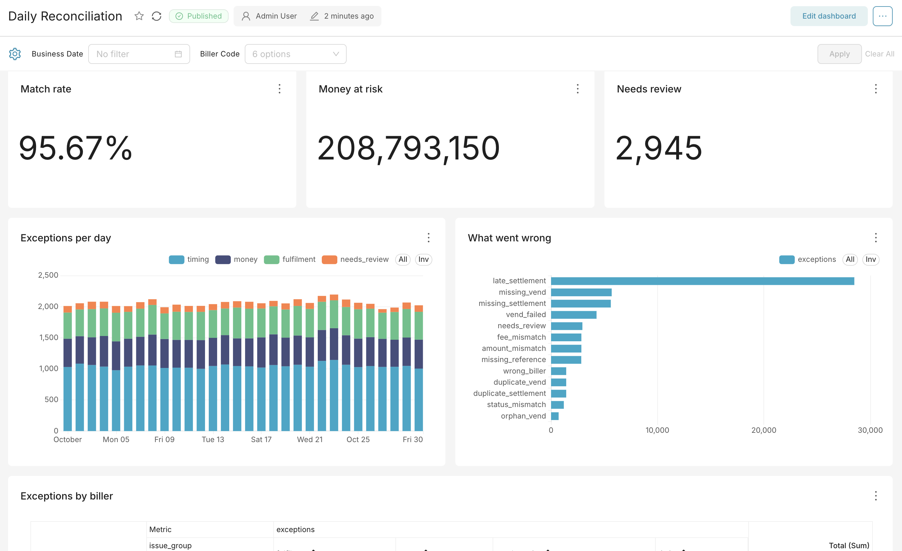

# Payments reconciliation pipeline

Three-way daily reconciliation of a fintech's ledger, processor settlements and
biller vending reports. Synthetic data, Postgres, dbt, Airflow and Superset.

A daily three-way reconciliation of a fintech's ledger, processor settlements and biller vends.
1.5M synthetic transactions with 12 kinds of injected errors. The pipeline flags every one,
with zero false alarms, and proves it against a ground-truth answer key on every push.

## The problem
A bill-payment platform takes the customer's money, the processor
settles it a day later, the biller vends the token. When the three disagree, money leaks or a
customer goes without power. Finance needs to know every morning what broke.

## Architecture
generator → data/landing (CSV) → loader → Postgres raw → dbt (staging → matching → marts)
→ Superset dashboard, orchestrated daily by Airflow, all in Docker.

| Layer | Tool | What it does |
|---|---|---|
| Ingest | Python, psycopg COPY | Loads each day's files as text, idempotently, with an audit log |
| Transform | dbt | Types and cleans, matches the three sources, one verdict per payment |
| Orchestrate | Airflow 3 | Daily load → build → grade, with backfill and retries |
| Serve | Superset 6 | Match rate, money at risk, exceptions by day and biller |
| Prove | pytest, dbt tests, grader, GitHub Actions | Every push checks the answers, not just the code |

## Results
- **100% precision** on all 12 error types: every flag is right.
- **100% caught**: every error is either named or sent for review. 2,945 payments go to review,
  because the processor's file can't tell same-day, same-amount payments apart. Guessing would be worse.
- Dashboard exception count = 61,751 = exactly the number of errors injected.

## Performance
| | Day 1 | Day 10 | Day 35 |
|---|---|---|---|
| Full rebuild | ~12 s | ~20 s | ~40 s, still growing |
| Incremental (7-day lookback) | 4 s | 20 s | 19 s, flat |

`EXPLAIN ANALYZE` showed full scans that no index could fix, so the fix was to read less.
A 35-day replay proves incremental builds match a full rebuild row for row (0 differences).
The replay also caught a real bug: an empty table's `max()` is NULL, which silently blocked all
settlements. Fixed with `coalesce(..., '-infinity')`.

## Run it yourself
    cp .env.example .env        # then set passwords
    make up                     # Postgres, Airflow (:8081), Superset (:8088)
    make data && make load && make build && make grade

## What I'd do next
- ask the processor for transaction time to clear the review queue;
- run tests only on recent days; 
- alerting when the grade or freshness fails.